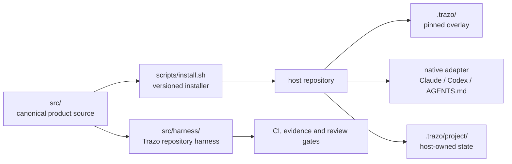

# Architecture

> This is the canonical source architecture for Trazo. It is installed as
> `.trazo/ARCHITECTURE.md` when a release is installed; the installed copy is pinned and
> must not be hand-edited. The current release's installed copy may therefore lag this
> document until the next release.

## Purpose and design intent

Trazo is a mountable governance framework for an existing repository. It gives an agentic
team one tool-neutral governance core, native adapters for the tools that discover them,
and a tested installer that places a pinned release into a host without taking ownership
of the host's code, runtime, or project state.

The source/install split is deliberate: `src/` is the editable product source, while
`.trazo/` is the installed release that governs this repository. Keeping those copies at a
release boundary prevents an agent from changing the rules governing its current session.
The durable decision is [ADR 0010](../../.trazo/project/adr/0010-src-canonical-trazo-pinned.md);
the complete decision map is the [ADR index](../../.trazo/project/adr/README.md).

## System shape

## Components and boundaries

| Component | Owns | Must not |
|---|---|---|
| `src/overlay/` | Tool-neutral rules, advisor, architecture guidance, roles, skills, hooks, and host document templates | Read as the installed copy or be replaced by edits made under `.trazo/` |
| `src/adapters/` | Native instruction and role adapters for Claude, Codex, and `AGENTS.md` | Define a second governance policy; adapters point back to the tool-neutral rules |
| `src/harness/` | Reusable repository harness files: CI, review/evidence scripts, security scanning, and PR template | Become part of a host's project state or overwrite host-owned files without the installer policy |
| `scripts/install.sh` | Installs and upgrades a pinned release from `src/` and preserves host-owned state | Overwrite `.trazo/project/`, secrets, or host-owned source/configuration |
| `.trazo/` | The installed, pinned framework files for this repository | Be hand-edited as product source; changes belong in `src/` and ship in a release |
| `.trazo/project/` | This repository's charter, plan, runbook, status, reports, workstreams, contract, and decision history | Be shipped to hosts or overwritten by an upgrade |

## Source, install, and state ownership

There are three distinct ownership classes:

1. Product source lives in `src/`. A source change is reviewed on its own branch and
   becomes available to hosts only through a release tag.
2. Installed framework files live in `.trazo/` and carry the release identity in
   `.trazo/VERSION`. The release installer may replace managed files according to its
   manifest, but this repository does not hand-edit them.
3. Project state lives in `.trazo/project/`. It records the decisions and work of this
   repository and is never copied into, or overwritten in, a host installation.

The root repository's `.github/`, `tests/`, `scripts/`, and `handbook/` exercise and
document Trazo itself. Only the explicitly packaged `src/overlay/`, `src/adapters/`, and
`src/harness/` surfaces are product inputs to the installer.

## Versioned interfaces

| Interface | Version boundary | Definition |
|---|---|---|
| Installed overlay | `.trazo/VERSION` release tag | `scripts/install.sh` and the managed files under `src/overlay/` |
| Native adapter contract | Same release tag as the overlay | `src/adapters/` and each adapter's native instruction file |
| Host architecture contract | Host-owned document, created from the release template | `src/overlay/templates/docs/ARCHITECTURE_CONTRACT.md` |
| Repository harness | Same release tag as the overlay | `src/harness/` and `scripts/install.sh` |

An upgrade may update managed framework and harness files, but it preserves host files that
the manifest records as edited and always preserves `.trazo/project/`.

## Decision and design authority

The [ADR index](../../.trazo/project/adr/README.md) is the entry point for why the system has
this shape. ADRs are append-only: a later record supersedes an earlier decision instead of
rewriting it. The current architecture describes the shape that exists now; the
[architecture contract](../../.trazo/project/ARCHITECTURE_CONTRACT.md) names the boundaries
and checks that this repository accepts.

When documents appear to conflict, resolve them in this order:

1. An accepted, later ADR controls the decision it explicitly supersedes or amends.
2. Otherwise, the current architecture controls the present component boundary and file
   ownership.
3. The architecture contract translates that boundary into the repository's interfaces
   and acceptance commands; it does not override an ADR or silently invent a new one.
4. A proposed ADR, issue, PR, or historical/superseded document is evidence or a proposal,
   not authority. If the conflict remains unresolved, stop the affected design choice and
   send it to the architect/PM rather than guessing.

## Explicit non-goals for v0.4.2

This baseline makes the design discoverable and reviewable. It does not implement the
automated startup/intake enforcement or mechanical role-separation work tracked for v0.5.0
(#198, #259, #260, #280, and #327). Those changes require their own design and acceptance
work; this document only records the boundary that they must respect.

## Change and acceptance rule

When a change alters this system's shape, update this source document in the same change and
link the relevant architecture section, contract section, and ADR(s) from the issue and PR.
Record commands and their results as acceptance evidence. Do not update the pinned
`.trazo/ARCHITECTURE.md` as a substitute for changing the source; it is updated by the next
release installation.
