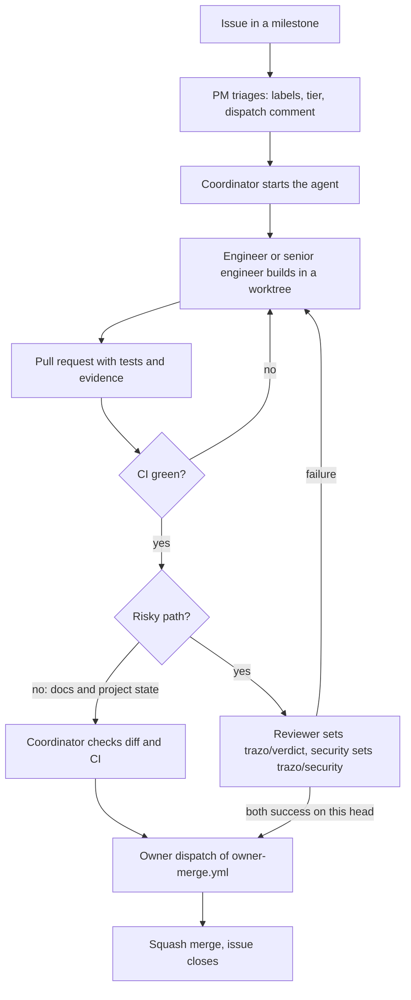

# How it works

Trazo is a set of rules, roles and checks that sit in a repository next to the code. Agents build the work. GitHub holds the state and the limits. The owner decides only what the rules reserve for the owner.

This page describes release v0.6.0 ([`.template/VERSION`](https://github.com/manoochehri/trazo/blob/main/.template/VERSION)). A claim that has not been proven on a live run is marked UNVERIFIED in its sentence. The status lines of ADR 0029, 0031 and 0032 still read proposed on `main`; the rules they describe are in `rules.md` and apply.

## The loop

Every change follows one path. The state is in GitHub issues, labels, pull requests and commit statuses, not in a chat ([rules.md, "State lives in GitHub"](https://github.com/manoochehri/trazo/blob/main/.trazo/rules.md)).

In words:

1. An issue carries the work, its priority and its milestone. The PM triages it and records which agent should run it as a comment on the issue ([ADR 0025](https://github.com/manoochehri/trazo/blob/main/.trazo/project/adr/0025-pm-cannot-start-agents.md)).
2. The Coordinator starts that agent ([ADR 0029](https://github.com/manoochehri/trazo/blob/main/.trazo/project/adr/0029-the-front-door.md)).
3. The engineer works in its own git worktree on a branch from fresh `origin/main` and opens a pull request. The first line of the commit message carries `Closes #<n>`. It never merges ([engineer.md](https://github.com/manoochehri/trazo/blob/main/.trazo/roles/engineer.md)).
4. CI runs. A behavior change needs a regression test that failed first, and the pull request body records it ([rules.md, "Tests are evidence"](https://github.com/manoochehri/trazo/blob/main/.trazo/rules.md)).
5. The path risk decides the review (next sections).
6. `owner-merge.yml` squash-merges the pull request, or refuses and says why.

## The roles

Each role is defined once in [`.trazo/roles/`](https://github.com/manoochehri/trazo/tree/main/.trazo/roles). Claude Code runs them as pinned subagents and commands ([CLAUDE.md](https://github.com/manoochehri/trazo/blob/main/CLAUDE.md)).

| Role | Does | May not |
|---|---|---|
| Coordinator (front door) | The main session. Reads project state, dispatches the PM, starts the agents the PM records, routes pull requests to review, dispatches `owner-merge.yml`. | Edit repository files outside `.trazo/project/`, commit, or edit pull requests ([ADR 0029](https://github.com/manoochehri/trazo/blob/main/.trazo/project/adr/0029-the-front-door.md), [front_door_guard.py](https://github.com/manoochehri/trazo/blob/main/src/overlay/hooks/front_door_guard.py)). |
| PM | Plans, prioritizes, triages issues, writes issues, may close and reopen issues and edit labels ([ADR 0032](https://github.com/manoochehri/trazo/blob/main/.trazo/project/adr/0032-permissive-by-default.md)). | Start agents, merge, push, dispatch workflows, or remove `needs-decision` or `drive-halt` ([pm_bash_guard.py](https://github.com/manoochehri/trazo/blob/main/src/overlay/hooks/pm_bash_guard.py)). |
| Engineer | Builds the default issue: code, tests, commits, pull request. | Merge, set `trazo/verdict` or `trazo/security`, edit the charter, or decide scope and priority (it hands those to the PM with `needs-pm`). |
| Senior engineer | Started with `/senior-eng`. The same role on a stronger model, for issues labeled `tier:senior`: listed risky paths, large or ambiguous work, or after 2 failed review rounds ([ADR 0016](https://github.com/manoochehri/trazo/blob/main/.trazo/project/adr/0016-senior-engineer-tier.md), [ADR 0018](https://github.com/manoochehri/trazo/blob/main/.trazo/project/adr/0018-senior-tier-routing-accepted.md)). | Review its own work or ordinary pull requests, merge, or set a verdict ([senior-engineer.md](https://github.com/manoochehri/trazo/blob/main/.trazo/roles/senior-engineer.md)). |
| Reviewer | Reads a pull request in its own context, posts a review, and sets `trazo/verdict` for the head it read. | Edit files, or set any status except its own ([reviewer.md](https://github.com/manoochehri/trazo/blob/main/.trazo/roles/reviewer.md)). |
| Security | Checks secrets, permissions, workflows and dependencies, and sets `trazo/security`. | Edit files, or set any status except its own ([security.md](https://github.com/manoochehri/trazo/blob/main/.trazo/roles/security.md)). |
| Skeptic | Tries to break a numeric or empirical result against `SKEPTIC_BAR.md` before anyone acts on it. | Edit files or build the thing it checks ([skeptic.md](https://github.com/manoochehri/trazo/blob/main/.trazo/roles/skeptic.md)). |
| Architect | Advises on structure and ADRs, and may block a change that breaks a design invariant. Runs on demand in the main session, with no pinned subagent ([ADR 0021](https://github.com/manoochehri/trazo/blob/main/.trazo/project/adr/0021-architect-role.md)). | Write code or configuration ([architect.md](https://github.com/manoochehri/trazo/blob/main/.trazo/roles/architect.md)). |

The role commands are `/pm`, `/eng`, `/senior-eng` and `/architect`. Reviewer, security and skeptic are subagent-only: the Coordinator starts each in its own context, and there is no command for them ([CLAUDE.md](https://github.com/manoochehri/trazo/blob/main/CLAUDE.md)).

Role-authored issue descriptions and GitHub comments end with a role attribution footer under the shared rules ([rules.md, "Attribute role-authored GitHub posts"](https://github.com/manoochehri/trazo/blob/main/.trazo/rules.md)). Claude Code and Codex use their own adapters; other tools use the `AGENTS.md` adapter. The footer carries the model and an agent or session ID only when the role's context reports them, and omits unknown fields. GitHub still shows the shared account as the author, so the footer is self-reported attribution, not an independently verified identity.

Reviewer, security and skeptic run in their own contexts, never in the conversation that produced the work ([rules.md, "Roles are separated"](https://github.com/manoochehri/trazo/blob/main/.trazo/rules.md)).

Agents are permissive by default: ordinary shell constructs and routine GitHub writes are allowed. The stop list in `rules.md` and the owner-only limits win over that ([ADR 0032](https://github.com/manoochehri/trazo/blob/main/.trazo/project/adr/0032-permissive-by-default.md)).

## The merge gate

Reviewer and security are required for a risky pull request, not for every pull request ([ADR 0031](https://github.com/manoochehri/trazo/blob/main/.trazo/project/adr/0031-review-by-path-not-every-pr.md)).

**What is risky.** A path in [`CODEOWNERS`](https://github.com/manoochehri/trazo/blob/main/.github/CODEOWNERS), a path in the sensitive lists of [`scripts/report_verdict.py`](https://github.com/manoochehri/trazo/blob/main/scripts/report_verdict.py) (for example `scripts/`, `.github/`, `.claude/`, the rules, roles and ADRs, `Makefile`, `pyproject.toml`, `mkdocs.yml`), and anything under `src/` or under `.trazo/` outside `.trazo/project/`. Both names of a rename count. A diff that mixes risky and ordinary files is risky. A diff the classifier cannot classify is risky.

**What is not.** Ordinary documentation and project state: STATUS, PLAN, RUNBOOK, workstreams, reports.

[`owner-merge.yml`](https://github.com/manoochehri/trazo/blob/main/.github/workflows/owner-merge.yml) is the one merge path for any pull request. It runs only when the repository owner's account dispatches it from the default branch. The Coordinator may dispatch it; the shipped settings deny agents every other workflow dispatch. It refuses unless, at the head commit it read first:

- the pull request is open, not a draft, not from a fork, and targets the default branch;
- the latest run of every check on the head is success or skipped;
- for a risky diff, `trazo/verdict` and `trazo/security` are both `success` on that head;
- for a non-risky diff, `trazo/verdict` is absent or `success`, and `trazo/security` is absent or `success`. A `failure` or `pending` on either still refuses. The dispatch is the Coordinator's check of the diff and CI.

It then squash-merges with `--match-head-commit`, so a push after the check cannot slip in. Any error refuses. A new push changes the head and resets both statuses, so a fix needs a fresh review.

Known gaps:

- The reviewer and security statuses are set through the same GitHub account that dispatches the merge, so the gate cannot tell the agents apart from the owner. Pinning `trazo/verdict` to a separate reviewer App is not done ([#366](https://github.com/manoochehri/trazo/issues/366)).
- UNVERIFIED on a live run: that the workflow's token may squash-merge a pull request that edits files under `.github/workflows/`. If it cannot, the owner merges that one pull request by hand (comment in `owner-merge.yml`).

## The guards

Three hooks keep roles inside their lane. They are configured in the shipped `settings.json` and documented in the [hooks README](https://github.com/manoochehri/trazo/blob/main/src/overlay/hooks/README.md). Each fails closed: unparseable input or a missing script blocks the call.

- **Front door guard** ([`front_door_guard.py`](https://github.com/manoochehri/trazo/blob/main/src/overlay/hooks/front_door_guard.py)). Binds the main session only. It blocks file edits outside `.trazo/project/` and Bash that edits pull requests, makes empty commits, or writes files. The main session may also write its memory notes. The point is that the Coordinator dispatches an engineer instead of doing the work.
- **PM guard** ([`pm_bash_guard.py`](https://github.com/manoochehri/trazo/blob/main/src/overlay/hooks/pm_bash_guard.py)). An allowlist of exact command shapes: read-only `git` and `gh`, issue and label commands, and a few filters. The PM has no `Agent` tool, so it cannot start a subagent that escapes the allowlist ([ADR 0025](https://github.com/manoochehri/trazo/blob/main/.trazo/project/adr/0025-pm-cannot-start-agents.md)).
- **Engineer guard** ([`engineer_bash_guard.py`](https://github.com/manoochehri/trazo/blob/main/src/overlay/hooks/engineer_bash_guard.py)). Since v0.6.0 a short blocklist over the parsed command. It denies the routes that merge, set statuses, change repository settings or secrets, push to the default branch, write to `.claude/` or `.trazo/` outside `project/`, or read `.env`-style paths. Ordinary shell is allowed.

A separate hook, [`agent_role_guard.py`](https://github.com/manoochehri/trazo/blob/main/src/overlay/hooks/agent_role_guard.py), lets only the pinned roles start as subagents.

These are speed bumps, not security boundaries. The hooks README lists what still gets through (`curl` with a token, shell variables and globs, `python -c`, and others). The limits that hold are GitHub's: the ruleset, `CODEOWNERS` and the gates above. Several hook input shapes are UNVERIFIED against a recorded payload (hooks README).

## The drive workflow

[`drive.yml`](https://github.com/manoochehri/trazo/blob/main/.github/workflows/drive.yml) is an unattended driver ([ADR 0024](https://github.com/manoochehri/trazo/blob/main/.trazo/project/adr/0024-unattended-drive-workflow.md)). It runs on a schedule and on manual dispatch, only from the default branch, and only while the repository variable `DRIVE_ENABLED` is `true`.

It has four jobs. `work` picks one ready issue and has an agent produce a patch with a read-only token. `publish` (no model) applies the patch, opens the pull request. `stuck` (no model) labels the issue `needs-pm` when no usable change came back. `merge` (no model) squash-merges a drive pull request only if this head has `trazo/verdict` success, checks pass, no blocking label is set, and the classifier says no owner-protected path changed.

The picker takes the open milestone first in due-date order, then issues by priority (P0, P1, P2, unlabeled) and age. It skips issues labeled `needs-decision`, `needs-pm` or `epic`, titles starting `Decide:`, issues with an open pull request, issues with an open blocker, and issues not written by the owner, a member or a collaborator.

Backstops, all repository variables with defaults, where a bad value falls back to the default ([ADR 0027](https://github.com/manoochehri/trazo/blob/main/.trazo/project/adr/0027-drive-spend-cap-and-runaway-guardrails.md)):

| Backstop | Default |
|---|---|
| `DRIVE_ENABLED` kill switch | off unless `true` |
| One open drive pull request at a time | fixed |
| `DRIVE_MAX_MERGES_PER_DAY` | 5 |
| `DRIVE_MAX_RUNS_PER_DAY` | 4 |
| `DRIVE_MAX_USD_PER_RUN` | 2 |
| An open `drive-halt` issue stops work and merge; a breaker opens one after two failures in a row | fixed |

A halt is closed by the owner, or once automatically after a fix merges and CI is green, at most once per 24 hours ([ADR 0030](https://github.com/manoochehri/trazo/blob/main/.trazo/project/adr/0030-drive-halt-clears-itself-once.md)).

**Live status: UNVERIFIED.** The drive has not completed an unattended run that merged a change. The first live run (2026-11-28, run 46114399415) produced no usable change, and its `stuck` job then failed to label the issue ([#399](https://github.com/manoochehri/trazo/issues/399), still open). A later run also produced no pull request ([#398](https://github.com/manoochehri/trazo/issues/398), [#401](https://github.com/manoochehri/trazo/issues/401)). The live check is [#247](https://github.com/manoochehri/trazo/issues/247). Until one full unattended run merges, treat every statement about the drive here as the design, not a result.

## Release automation

[`release.yml`](https://github.com/manoochehri/trazo/blob/main/.github/workflows/release.yml) cuts the release tag and [`merge-audit.yml`](https://github.com/manoochehri/trazo/blob/main/.github/workflows/merge-audit.yml) audits merges. Both belong to Trazo's own repository and are not shipped to hosts. A release is a milestone: the tag is cut only when the milestone has no open issues, a changelog entry exists and CI is green ([rules.md, "Release when there is something to release"](https://github.com/manoochehri/trazo/blob/main/.trazo/rules.md)). UNVERIFIED on a live run: that the builder App may create the tag through the ruleset bypass (comment in `release.yml`, [`allow_release_app.py`](https://github.com/manoochehri/trazo/blob/main/scripts/allow_release_app.py)).

## What the owner still decides

Anything on the stop list in `rules.md`: the charter, `CODEOWNERS` paths, agent rules and role files, workflows and build configuration, secrets, spend, production, permissions and repository settings, and scope or priority. An agent that reaches one stops and labels the issue `needs-pm`; the PM escalates to `needs-decision` when the choice is the owner's ([rules.md, "Ask before guessing"](https://github.com/manoochehri/trazo/blob/main/.trazo/rules.md)).

## Related pages

- [Guardrails and limits](guardrails.md): every limit, how GitHub and the hooks enforce it, and where enforcement can fail.
- [Use it](use-it.md): what you do each day and what to do when something is stuck.
- [In your repo](in-your-repo.md): what Trazo adds to your repository and what stays yours.
